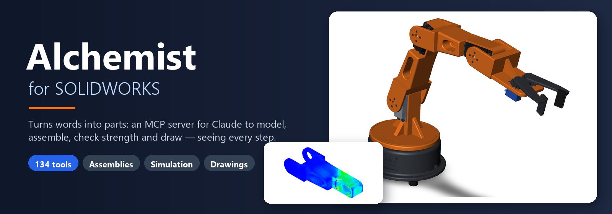
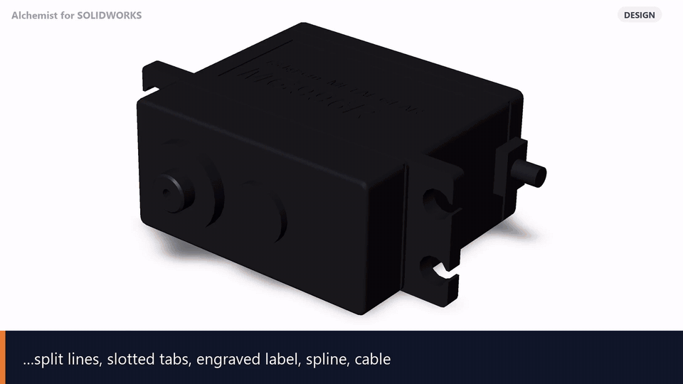

<p align="center"></p>

<p align="center">
<a href="README.md">English</a> · <b>Русский</b> · <a href="README.zh-CN.md">简体中文</a>
</p>

<p align="center">


</p>

# Alchemist for SOLIDWORKS

*Превращает слова в детали.* Alchemist (алхимик) — MCP-сервер, через который **Claude** (и любой MCP-клиент) работает в **SOLIDWORKS**: строит детали по запросу обычными
словами, разбирает большие сборки, готовит листовой металл к лазеру и гибке и считает прочность в **SOLIDWORKS
Simulation** — и при этом **видит** модель: каждый вид и каждая эпюра напряжений приходят в чат картинкой.

<p align="center"></p>
<p align="center"><sub>Один разговор, без мыши: Claude моделирует руку робота для 3D-печати до последнего винта
(17 деталей, 64 компонента), двигает её, находит, что привод плеча не удержит груз, и заменяет его, проверяет
печатное плечо в Simulation и CalculiX и делает чертёж. Видео целиком: <a href="assets/demo_ru.mp4">assets/demo_ru.mp4</a></sub></p>

Начинался как форк [SolidPilot](https://github.com/eyfel/mcp-server-solidworks) Çağatay Bakan и вырос с 47 до
**134 инструментов**: сборки, листовой металл, сварные конструкции, Simulation со сверкой в CalculiX, чертежи и спецификации по ГОСТ.

## Что можно попросить

| Область | Примеры |
|---|---|
| **Моделирование** | «Сделай пластину 120×80×10 с четырьмя отверстиями Ø9 в 10 мм от краёв и скруглениями 3 мм», «Поверни этот эскиз вокруг оси», «Размножь паз 6 раз по кругу», протяжки, лофты, Hole Wizard, конфигурации, свойства. Эскизы получаются **полностью определёнными**, с конструкторскими размерами |
| **Сборки** | «Покажи сборку спереди», «Найди пересечения», «Какие детали ближе 3 мм друг к другу?», «Масса и центр тяжести рамы», «Измени Distance1 на 25 мм», «Вставь болт в отверстие пластины и размножь 4 шт через 30 мм», «Сделай pack and go в D:\копия» |
| **Листовой металл** | «Сводка листовых деталей по толщинам», «Выгрузи DXF развёрток с именами по обозначению и слоями для лазера», «Сделай ведомость раскроя в Excel», «Проверь технологичность: отверстия у гибов, короткие полки», «Добавь подгибку 8 мм», «Преобразуй коробку в листовой металл» |
| **Прочность** | «Посчитай кронштейн: заделка по грани 4, сила 500 Н вниз на грань 9, сталь AISI 1020» → напряжения, перемещения, запас прочности, где максимум и **картинка эпюры**; контакты, болты и швы; ручные проверки болтов, швов и балок (EN 1993-1-8); HTML-отчёт; независимая сверка в **CalculiX** на той же сетке |
| **Сварные и спецификации** | «Построй раму из трубы 40×40×2 по эскизу», обрезка, заглушки, косынки, ведомость резки профиля, спецификация по ГОСТ 2.106 в Excel |
| **Чертежи** | виды в проекционной связи на листе в стандартном масштабе, размеры вынесены за виды (при желании — только названных элементов), без дублей, разрезы, выноски отверстий, таблица BOM, экспорт PDF / DXF; чтение чертежа DXF / DWG и построение детали по нему |
| **Покупные модели** | «Сконвертируй все STEP в папке в детали SOLIDWORKS» |

## Как устроено

```
Claude ⇄ MCP ⇄ адаптер (Python, adapters/claude) ⇄ HTTP ⇄ SolidworksExecution.exe (C#) ⇄ COM ⇄ SOLIDWORKS
```

- **Адаптер** описывает инструменты для Claude и сам запускает сервер исполнения при первом вызове.
- **SolidworksExecution.exe** — фоновый сервер без окна, вызывает API SOLIDWORKS. Собирается при установке против API
  **установленного** у вас SOLIDWORKS, поэтому всегда совпадает с вашей версией.
- По умолчанию Claude работает в **своём скрытом экземпляре SOLIDWORKS** и не мешает вам
  (`install.ps1 -SharedInstance` — работать в вашем открытом окне).
- Все инструменты говорят в **миллиметрах и градусах** (Simulation — мм, Н, МПа) и отвечают одним JSON-объектом.

## Установка

Нужно: Windows, **SOLIDWORKS** (проверено на 2024 SP1; для расчётов — с SOLIDWORKS Simulation), **Python 3.11+**,
Claude Desktop или Claude Code.

```powershell
git clone https://github.com/AlchemistCache/alchemist-solidworks-mcp.git
cd alchemist-solidworks-mcp
powershell -ExecutionPolicy Bypass -File .\install.ps1
```

Установщик создаёт `.venv`, ставит зависимости, собирает `SolidworksExecution.exe` (компилятор C# скачивается с
nuget.org один раз, ~21 МБ) и регистрирует сервер `solidworks` в Claude Desktop (с резервной копией конфига).
Затем **перезапустите Claude**.

Ключи: `-Test` — smoke-тест на живом SOLIDWORKS, `-SharedInstance`, `-NoRegister`, `-Dev` (pytest, ruff),
`-SwApiDir <папка SOLIDWORKS>\api\redist` — если SOLIDWORKS установлен не в `C:\Program Files\SOLIDWORKS Corp\SOLIDWORKS`.

**Обновление:** `git pull`, затем снова `install.ps1` (пересоберёт exe).

## Инструменты

**134 инструмента** по группам; полный список с параметрами — [docs/TOOLS.md](docs/TOOLS.md) (на английском).
Группы с пометкой *по запросу* выключены, пока ими не пользуются, чтобы не тратить контекст: Claude находит их
инструменты через `tool_help` и вызывает через `execute_batch`, а тот включает группу (дальше она включена 30 дней).

<!-- tools:start -->
| Группа | Инструменты |
|---|---|
| **Документы и файлы** (16) | `ensure_ready`, `open_new_part`, `open_document`, `export_document`, `verify_state`, `close_document`, `save_document`, `get_selection`, `set_part_material`, `activate_document`, `batch_export_files`, `unreferenced_files`, `run_macro`, `import_step`, `import_step_folder`, `set_document_units` |
| **Эскизы** (10) | `create_sketch`, `add_sketch_entity`, `add_sketch_entities`, `sketch_modify`, `add_sketch_constraint`, `add_dimension`, `define_sketch`, `edit_sketch`, `modify_dimension`, `add_sketch_text` |
| **Элементы детали** (13) | `extrude_feature`, `create_rib`, `hole_wizard`, `add_edge_feature`, `add_reference_geometry`, `create_pattern`, `edit_feature`, `list_materials`, `add_plane_angle`, `add_axis_two_points`, `sweep_pipe`, `loft`, `set_body_visibility` |
| **Чертежи** (15) · *по запросу* | `create_drawing`, `add_drawing_view`, `add_flat_pattern_view`, `add_drawing_dimension`, `auto_dimension_drawing`, `auto_center_marks`, `add_hole_callout`, `add_section_view`, `analyze_drawing`, `check_drawing`, `move_drawing_view`, `layout_drawing_views`, `dedupe_drawing_dimensions`, `add_dimension_between`, `insert_bom_table` |
| **Чтение модели и проверка** (4) | `analyze_model`, `compare_parts`, `compare_assemblies`, `dimension_for_face` |
| **Фоновые задачи и пакеты** (2) | `job_result`, `execute_batch` |
| **Сборки** (31) | `list_components`, `delete_components`, `list_open_documents`, `interference_check`, `clearance_check`, `measure_components`, `mass_properties`, `list_references`, `get_custom_properties`, `bom_export`, `bom_gost`, `set_component_state`, `set_appearance`, `move_component`, `replace_component`, `pack_and_go`, `set_custom_properties`, `configurations`, `form_subassembly`, `export_components`, `list_mates`, `edit_mate`, `add_mate_advanced`, `insert_and_mate`, `pattern_components`, `constraint_status`, `open_new_assembly`, `analyze_assembly`, `insert_component`, `add_mate`, `save_body_as_part` |
| **Листовой металл** (10) · *по запросу* | `sheet_metal_cutlist`, `sheet_metal_hem`, `sheet_metal_miter_flange`, `sheet_metal_cross_break`, `sheet_metal_gusset`, `convert_to_sheet_metal`, `sheet_metal_info`, `export_flat_dxf`, `sheet_metal_dfm`, `sheet_metal_feature` |
| **Прочность: SOLIDWORKS Simulation и ручные проверки** (22) · *по запросу* | `sim_status`, `sim_create_study`, `sim_delete_study`, `sim_set_material`, `sim_add_fixture`, `sim_add_load`, `sim_contact`, `sim_mesh`, `sim_run`, `sim_results`, `sim_plot`, `sim_image`, `sim_crosscheck`, `sim_connector`, `sim_contact_set`, `sim_mesh_control`, `sim_options`, `sim_copy_study`, `sim_report`, `bolt_check`, `weld_check`, `beam_check` |
| **Сварные конструкции** (7) · *по запросу* | `weldment_profiles`, `create_weldment_profiles`, `weldment_member`, `weldment_cut_list`, `weldment_trim`, `weldment_end_cap`, `weldment_gusset` |
| **Изображения модели** (2) | `view_image`, `view_images` |
| **Справка** (1) | `tool_help` |
| **Группы инструментов** (1) | `enable_tools` |
<!-- tools:end -->

## Скиллы Claude

В `skills/` — готовые сценарии: **sheet-assembly-strength** (прочность листовой детали или сборки: закрепления,
нагрузки, контакты, сетка, эпюры, ручная сверка, отчёт) и **sheet-metal-production** (лист в производство:
технологичность, DXF для лазера, ведомость раскроя, спецификация). `install.ps1` ставит их в Claude Code
(`%USERPROFILE%\.claude\skills`) и кладёт zip в `dist\skills` — в Claude Desktop загрузите их в «Настройки →
Возможности → Навыки».

## Советы

- Начинайте сессию с «подготовь SolidWorks» (`ensure_ready`) — первый запуск скрытого SOLIDWORKS занимает до минуты.
- Индексы граней и рёбер для операций Claude берёт из `analyze_model(faces / edges)` и `analyze_assembly`.
- Длинные описания инструментов сокращены (примерно на треть меньше контекста на каждый запрос); полный текст и
  справки по темам — `tool_help`. Полные описания всегда: переменная окружения `SWMCP_DOCS=full`.
- Группы: по умолчанию включены только базовые инструменты и сборки; группа, которой пользовались последние 30 дней,
  включается сама. Настройка — `SWMCP_TOOLS` в `adapters/claude/.env` (`all` — все).
- Лист в Simulation считается оболочками: нагрузки ставьте на большие грани листа, не на торцы толщины.
- VBA-макросы (`run_macro`) запускаются только из папки `macros\` проекта.
- Исследования Simulation хранятся в документе — сохраните деталь / сборку, чтобы они не пропали.
- Долгие операции на больших сборках через ~45 с отвечают `{"running": true, "job_id": …}` и продолжают работать;
  Claude забирает результат инструментом `job_result` (клиенты MCP обрывают вызов примерно через 60 с).

## Проблемы

| Симптом | Что делать |
|---|---|
| Непонятно, что не так | `.venv\Scripts\python.exe tools\doctor.py` — Python и пакеты, SOLIDWORKS и Simulation, exe собран и свежий, сервер, регистрация |
| Инструментов `solidworks` нет в Claude | перезапустить Claude; проверить `tools\register_claude.py` |
| `COM_ATTACH_FAILED` | SOLIDWORKS и Claude запущены с разными правами (один «от администратора»), или висит диалог / лицензия |
| Ошибка сборки при установке | SOLIDWORKS не в стандартной папке → `install.ps1 -SwApiDir ...` |
| `SIMULATION_UNAVAILABLE` | нет лицензии / надстройки SOLIDWORKS Simulation |
| Логи | `execution\solidworks\SolidworksExecution\bin\Debug\execution.log`, `adapters\claude\adapter.log` |

## Документация (на английском)

- [docs/TOOLS.md](docs/TOOLS.md) — все инструменты с параметрами (генерируется)
- [docs/DEVELOPMENT.md](docs/DEVELOPMENT.md) — структура, как добавить инструмент, тесты
- [docs/SOLIDWORKS_API_NOTES.md](docs/SOLIDWORKS_API_NOTES.md) — как на самом деле ведёт себя API SOLIDWORKS 2024
- [CONTRIBUTING.md](CONTRIBUTING.md) — соглашения и как участвовать
- [THIRD_PARTY_NOTICES.md](THIRD_PARTY_NOTICES.md) — код и идеи из других форков

## Лицензия

AGPL-3.0 (см. [LICENSE](LICENSE)), как и исходный SolidPilot © Çağatay Bakan. SOLIDWORKS — товарный знак Dassault
Systèmes; проект не связан с Dassault Systèmes и Anthropic и не одобрен ими.
